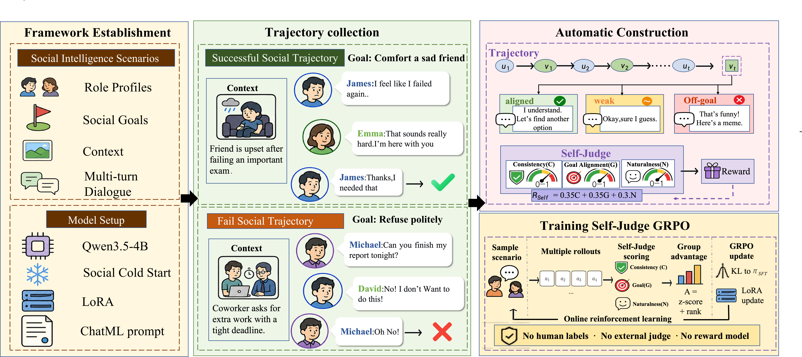

# SocialJudge

**SocioJudge: How Far Can a Small Language Model Go in Social Intelligence?**

SocioJudge studies social dialogue training for a compact language model. It combines automatically curated interaction trajectories, supervised fine-tuning, and reinforcement learning with rewards generated by the policy itself.

## Approach

1. **Construct social trajectories.** Simulate interactions with role profiles, social goals, and contextual information. Evaluate outcomes and rewrite selected turns to create additional successful examples.
2. **Train a social dialogue policy.** Use SocioJudge-12K, a collection of more than 12,000 trajectory–turn examples, for supervised cold-start training of SocioJudge-4B.
3. **Optimize with self-judged rewards.** Apply Group Relative Policy Optimization (GRPO), combining scores for character consistency, goal progress, and naturalness with a repetition penalty.

An external model supports trajectory generation and outcome evaluation during data construction. During online reinforcement learning, the policy generates the self-judge scores. External evaluation is separate from this training reward.

## Evaluation

The manuscript evaluates interactive social behavior using AgentSense scenarios and social and emotional reasoning using SocialIQA and EmoBench.

| Model | AgentSense: Social Quality | AgentSense: Goal Alignment | SocialIQA accuracy | EmoBench accuracy |
|:--|--:|--:|--:|--:|
| SocioJudge-4B | 91.2 | 86.7 | 100.0% | 92.7% |
| Qwen3.5-4B base | 72.3 | 68.5 | 82.4% | 78.5% |

These are the manuscript's reported results. AgentSense scores use a 0–100 scale; SocialIQA and EmoBench scores are accuracies. The comparisons describe the complete training pipeline.

## Release status

This repository currently provides the project overview and framework figure. Training code, evaluation scripts, model checkpoints, and the SocioJudge-12K dataset are being prepared for release. Installation and reproduction instructions will accompany those artifacts.

## Related resources

- [AgentSense — NAACL 2025](https://aclanthology.org/2025.naacl-long.257/)
- [Social IQa — EMNLP-IJCNLP 2019](https://aclanthology.org/D19-1454/)
- [EmoBench — ACL 2024](https://aclanthology.org/2024.acl-long.326/)
- [SOTOPIA-π — ACL 2024](https://aclanthology.org/2024.acl-long.698/)
- [DeepSeekMath / GRPO](https://arxiv.org/abs/2402.03300)

## Citation and license

Paper citation and release licensing will be added with the research artifacts. Third-party datasets and models retain their respective terms.
